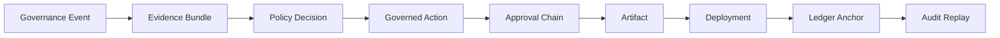
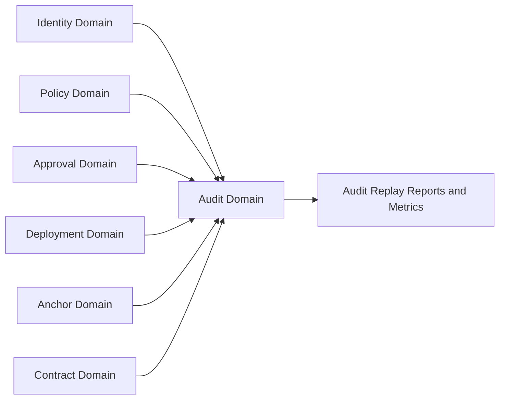
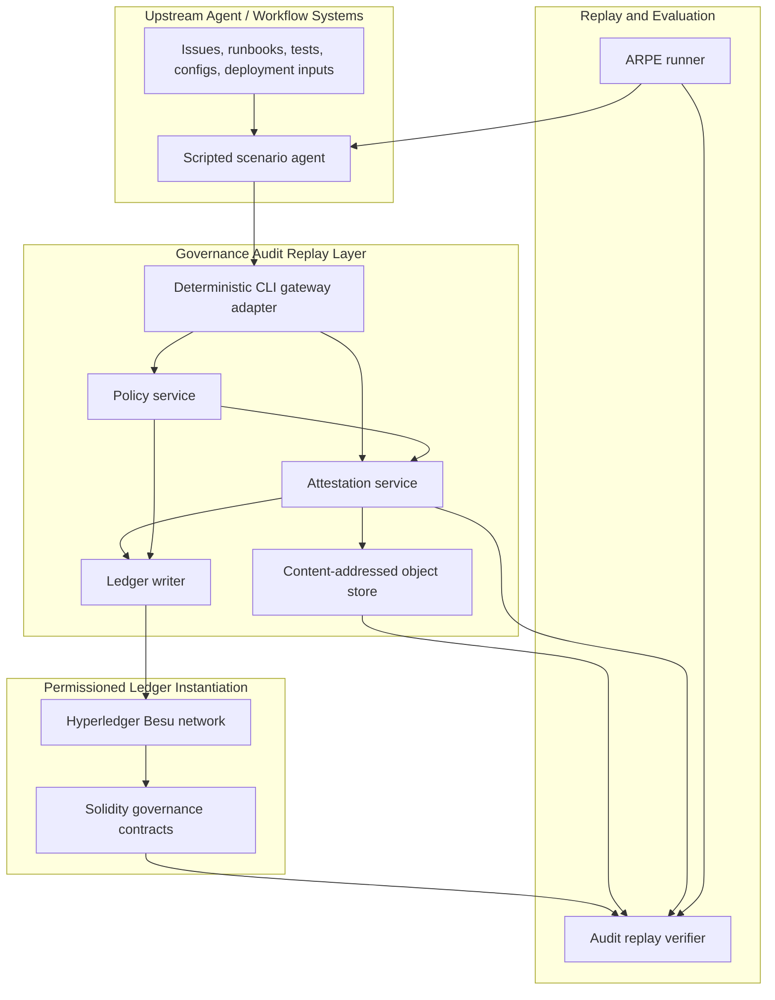
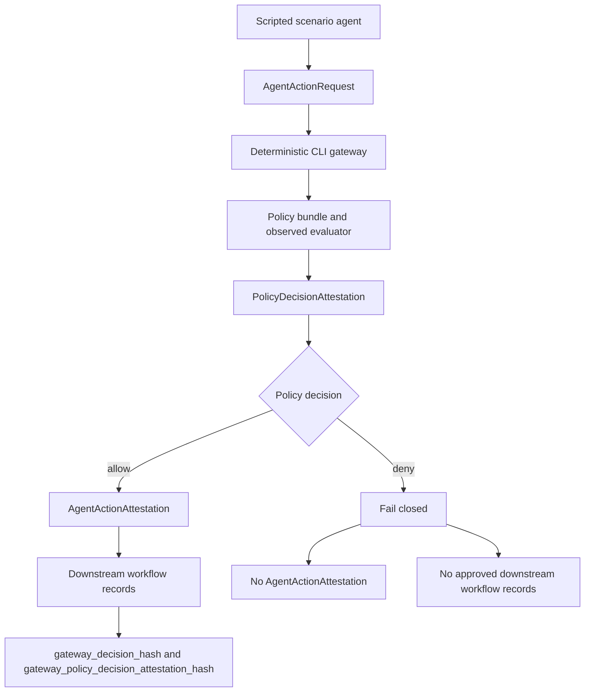
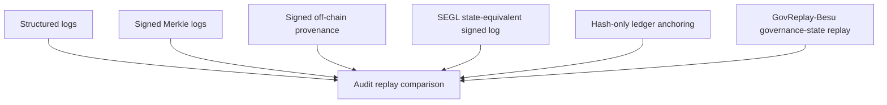

# GovReplay Architecture

GovReplay is a governance audit replay software suite and reference
implementation for verifiable audit replay of agentic software-delivery
workflows. It binds governed actions to the
evidence, policy version, policy decision, approval chain, artifact,
deployment, and ledger state needed to replay historical governance decisions
after policies evolve.

Hyperledger Besu and Solidity are the current implementation instantiation.
They provide permissioned Ethereum governance state for the full artifact path.
The current CISS study focuses on represented-actor authority at first commitment N,
deployment conditions at D and the targeted role guard. See
[the evaluation guide](docs/ciss-evaluation.md). The broader lifecycle and ARPE
modules below remain available as historical/optional prototype paths.

## Overview

GovReplay separates four concerns:

- governed workflow execution and evidence collection;
- policy evaluation and obligation resolution;
- signed off-chain governance evidence over actions, approvals, and artifacts;
- optional ledger-backed governance state for independently verifiable actor,
  policy, approval, deployment, anchor, and contract-directory history.

Raw evidence, prompts, source files, and generated artifacts stay off-chain.
The ledger stores compact identifiers, hashes, roots, state transitions, and
events that the audit replay verifier can read back.

## Core Lifecycle



The audit replay verifier reconstructs this lifecycle from a deployment ID,
workflow ID, attestation hash, or ledger transaction reference. For each step it
checks the required links, hashes, signatures, policy-version bindings,
approval records, artifact/deployment consistency, and ledger state available
for the selected system configuration.

## Governance Domains

The current evaluation is single-organization but multi-domain. A governance
domain is an authority boundary inside the evaluated organization, not a
separate organization. Generated workload, ground-truth, fault, replay, and
metrics records carry `governance_domain`, `governance_domain_type`, and
`governance_domain_id` fields so audit replay can distinguish identity, policy,
approval, deployment, anchor, contract-directory, and audit-report boundaries.



Multi-organization federation would require scoping actor, policy, approval,
deployment, anchor, and contract-directory state by organization or by a wider
domain namespace. That federation layer is future work and is not implemented
or evaluated by ARPE.

## Component Architecture



The implemented gateway boundary is a deterministic CLI adapter for scripted
paper scenarios. It is not a production HTTP service, SDK, MCP gateway,
LangGraph adapter, AutoGen adapter, live LLM-agent runtime, or general agent
framework. Those transports and framework integrations remain optional future
adapters around the same `AgentActionRequest` and attestation contract.

The component boundary is intentionally modular. The same governance model can
be evaluated as structured logs, signed off-chain governance evidence, a signed
event-sourced governance log, hash-only ledger anchoring, or full Besu-backed
governance-state replay.

## Deterministic Gateway Boundary

The current gateway is a pre-action control point for repeatable reviewer and
paper scenarios. A scripted scenario agent submits an `AgentActionRequest` with
the scenario ID, actor roles, action, resource, policy bundle reference,
evidence references, artifact references, approval references, and deployment
references. The gateway maps the request into policy input, evaluates the
policy bundle with the shared policy evaluator, emits a signed
`PolicyDecisionAttestation` for every observed decision, and fails closed when
policy denies the proposed action.



Allowed requests produce policy and action attestations. The deterministic
example client then writes scenario-specific downstream workflow records only
after the allow decision. Those downstream records carry both
`gateway_decision_hash` and `gateway_policy_decision_attestation_hash` so replay
can link approved actions, approvals, artifacts, deployments, configuration
changes, patch records, and governance-state changes back to the gateway
decision.

Denied requests produce the policy decision record only. They do not produce an
`AgentActionAttestation`, and the deterministic client writes no approved
downstream workflow records.

## Gateway Scenario Suite

PX-S29 extends the gateway suite across five deterministic software-delivery
domains:

| Scenario | Action type | Primary coverage |
| --- | --- | --- |
| `S1_runbook_update` | `propose_runbook_update` | Evidence sufficiency and policy decision binding. |
| `S2_configuration_change` | `propose_config_change` | Actor roles, approval authority, and separation of duties. |
| `S3_patch_proposal` | `propose_patch` | Issue/test evidence, patch artifact linkage, and supply-chain-style provenance. |
| `S4_policy_gated_deployment` | `deploy_artifact` | Approved artifact linkage, deployment record emission, and ledger-anchor evidence. |
| `S5_governance_state_change` | `request_governance_state_change` | Governance-admin authority for policy or governance-state transitions. |

Each scenario has one allowed fixture and one denied fixture under
`packages/gateway/fixtures/`. The canonical validation target is:

```powershell
docker compose run --rm gateway-test
```

The smoke run writes generated outputs under ignored
`runs/gateway-smoke/` paths for reviewer inspection.

## On-Chain Vs Off-Chain Boundary

| Off-chain | On-chain in `govreplay_besu` |
| --- | --- |
| raw evidence documents | actor and role state |
| prompts, runbooks, tests, configs, and generated artifacts | policy registration and activation history |
| signed attestation envelopes | approval records and approval roots |
| content-addressed object store entries | deployment records and artifact hashes |
| local run manifests and replay reports | provenance anchors and Merkle roots |
| ARPE ground truth and metrics | contract-directory state and event history |

The ledger is used when replay needs shared governance state that a mutable
application database should not be trusted to provide by itself. It is not used
as raw data storage.

## ARPE Evaluation Configurations

Audit Replay under Policy Evolution (ARPE) is an author-defined synthetic
evaluation for controlled governance replay. It compares the ability of each
configuration to reconstruct lifecycle links, detect injected faults, localize
failures, classify policy drift, and characterize operational overhead.



| Configuration | Ledger-state requirement | Replay semantics |
| --- | --- | --- |
| `baseline_structured_logs` | `no_ledger_state_required` | Parses conventional lifecycle fields without cryptographic replay. |
| `baseline_signed_merkle_log` | `no_ledger_state_required` | Verifies signed append-only event integrity but not shared governance state. |
| `govreplay_offchain_only` | `no_ledger_state_required` | Verifies signed attestations, hashes, content-addressed evidence, and lifecycle links. |
| `SEGL` | `signed_event_sourced_governance_state` | Folds append-only signed transition events into historical actor, policy, approval, deployment, anchor, and contract-directory state without Besu. |
| `baseline_hash_only_ledger` | `ledger_anchor_readback` | Verifies deterministic anchor presence/readback without registry-backed governance semantics. |
| `govreplay_besu` | `ledger_backed_governance_state` | Verifies off-chain governance evidence plus actor, policy, approval, deployment, anchor, and contract-directory state. |

ARPE faults are synthetic and controlled by design. They support comparison
against ground truth; they are not a claim of compliance with SLSA, in-toto,
Rekor, SCITT, DARPA TC, OpTC, ProvSec, or any external suite.

The configurations deliberately do not provide the same governance state.
Structured logs provide conventional fields; signed Merkle logs provide event
integrity; signed off-chain provenance provides signed attestations and content
hashes; SEGL reconstructs governance state from signed event-sourced transition
records; hash-only ledger anchoring proves anchor presence/readback without
registries; `govreplay_besu` verifies against Besu-backed actor, policy,
approval, deployment, anchor, and contract-directory state.

## Ledger-State Requirements

`no_ledger_state_required`

The verifier can make the relevant determination from local logs, signatures,
hashes, policy identifiers, content-addressed objects, and replay reports. These
cases test lifecycle completeness and off-chain integrity.

`ledger_anchor_readback`

The verifier must read a ledger anchor or anchor manifest back and compare it
with the off-chain root or attestation hash. This class tests whether anchoring
exists and matches, but it does not require smart-contract governance registries.

`ledger_backed_governance_state`

The verifier must consult ledger-maintained governance state such as active
policy history, actor roles, approval records, deployment records, provenance
anchors, or contract-directory history. This class is where GovReplay-Besu is
expected to differ from signed-log and off-chain-only configurations.

## Audit Replay Verification Levels

| Level | Verification focus | Typical inputs |
| ---: | --- | --- |
| 0 | File presence, schema shape, and run-layout consistency | run manifests, JSON Schemas, replay fixtures |
| 1 | Local cryptographic integrity | canonical hashes, signatures, parent links, content-addressed objects |
| 2 | Policy and obligation replay | policy bundles, policy-decision records, required evidence and approvals |
| 3 | Ledger anchor readback | attestation roots, transaction/event exports, anchor records |
| 4 | Ledger-backed governance state | actor roles, active policies, approvals, deployments, contract-directory history |

Configurations can satisfy different levels. The structured-log baseline is
expected to support basic reconstruction but not cryptographic or ledger-backed
verification. SEGL exercises the same state-reconstruction semantics without a
ledger, while GovReplay-Besu exercises all levels including independently
administered ledger-backed governance state.

## Reproducibility Path

The authoritative validation path is Docker Compose from the repository root:

```powershell
docker compose run --rm gateway-test
docker compose run --rm foundry
docker compose run --rm attestations-test
docker compose run --rm policy-bundle-test
docker compose run --rm policy-service-test
docker compose run --rm scenario-runner-test
docker compose run --rm audit-replay-test
docker compose run --rm experiment-runner-test
docker compose run --rm result-provenance-gate
docker compose --profile besu_live_arpe_full run --rm paper-arpe-full
```

Live Besu validation has two explicit levels. The smoke path is a quick
contract deployment/write/readback check:

```powershell
$env:GOVPROV_DEV_DEPLOYER_PRIVATE_KEY="<local-dev-private-key>"
docker compose --profile besu-dev up -d besu-dev
docker compose --profile besu-dev run --rm besu-live-smoke
docker compose --profile besu-dev down
```

The older `paper-arpe` service remains a faster debug subset. The paper-facing
deterministic command is `paper-arpe-full`, because it regenerates the basic
matrix, hard matrix, and hash-only hard ablation used by the manuscript. The
full live ARPE path then writes the GovReplay-Besu basic and hard subsets
through live Besu RPC and contract calls:

```powershell
$env:GOVPROV_DEV_DEPLOYER_PRIVATE_KEY="<local-dev-private-key>"
docker compose --profile besu_live_arpe_full run --rm paper-arpe-full
docker compose --profile besu_live_arpe_full up --build --exit-code-from besu-live-arpe-full besu-dev besu-live-arpe-full
docker compose down
```

The paper-facing ARPE path writes deterministic generated outputs under ignored
`runs/<run_id>/` directories. Those outputs separate ground truth, fault
injection, replay output, metrics, paper tables, and reproducibility metadata so
reviewers can inspect the boundary between expected outcomes and verifier
results. The `runs/besu-live-arpe-full/` outputs record that the GovReplay-Besu
replay backend is `live_besu_rpc` and that deterministic sidecars are preserved
only as oracle/debug artifacts. The full live profile emits one observed
verifier row for each of the 656 live workflows after querying contract state
through the RPC-backed Foundry script; the shell wrapper derives replay
success/failure counts from those rows and keeps receipt-derived transaction,
gas, and block counts separate from formula-derived verifier call totals.
